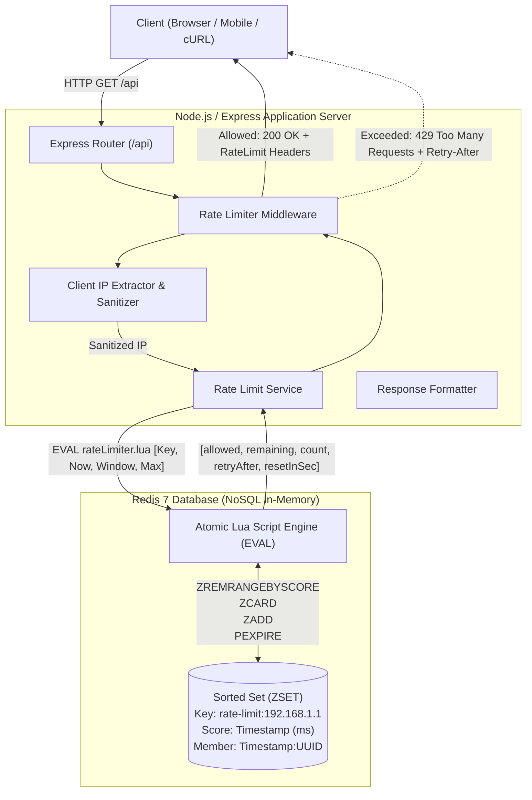
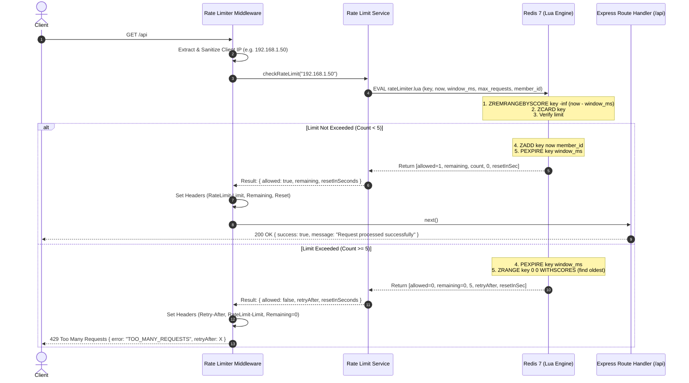

# Distributed NoSQL Rate Limiter (Sliding Window Log)

> **Unstructured Database (NoSQL) Assignment — Question 2**  
> **Engineered with:** Node.js, Express.js, Redis 7 (Sorted Sets & Lua Scripting), Docker Compose, and Jest.

---

## Table of Contents

1. [Project Introduction](#1-project-introduction)
2. [Problem Statement & Background](#2-problem-statement--background)
3. [Assignment Objectives & Compliance Matrix](#3-assignment-objectives--compliance-matrix)
4. [Technology Stack](#4-technology-stack)
5. [System Architecture](#5-system-architecture)
   - [High-Level Component Architecture](#high-level-component-architecture)
   - [Request Lifecycle & Execution Flow](#request-lifecycle--execution-flow)
6. [Sliding Window Log Algorithm Deep Dive](#6-sliding-window-log-algorithm-deep-dive)
   - [Why Sliding Window Log?](#why-sliding-window-log)
   - [Algorithm Comparison](#algorithm-comparison)
   - [Mathematical Formulation](#mathematical-formulation)
7. [Redis NoSQL Data Model](#7-redis-nosql-data-model)
   - [Data Structure: Sorted Sets (ZSET)](#data-structure-sorted-sets-zset)
   - [Key Naming Convention](#key-naming-convention)
   - [Member Uniqueness & Collision Prevention](#member-uniqueness--collision-prevention)
   - [Automatic Key Eviction & Memory Management](#automatic-key-eviction--memory-management)
8. [Atomic Redis Lua Scripting](#8-atomic-redis-lua-scripting)
   - [The Need for Atomicity](#the-need-for-atomicity)
   - [Step-by-Step Execution Walkthrough](#step-by-step-execution-walkthrough)
   - [Status Inspection Without Consumption](#status-inspection-without-consumption)
9. [Reliability, Security & Production Hardening](#9-reliability-security--production-hardening)
   - [Fail-Closed vs. Fail-Open Architecture](#fail-closed-vs-fail-open-architecture)
   - [Client IP Extraction & Reverse Proxy Security](#client-ip-extraction--reverse-proxy-security)
   - [Key Sanitization & Injection Defense](#key-sanitization--injection-defense)
   - [Graceful Process Shutdown](#graceful-process-shutdown)
10. [API Reference & Response Specifications](#10-api-reference--response-specifications)
    - [Response Headers](#standard-response-headers)
    - [`GET /api`](#get-api)
    - [`GET /api/health`](#get-apihealth)
    - [`GET /api/rate-limit/status`](#get-apirate-limitstatus)
    - [`GET /`](#get-)
11. [Environment Configuration](#11-environment-configuration)
12. [Installation & Execution Guide](#12-installation--execution-guide)
    - [Option A: Running Locally with Node.js and Redis](#option-a-running-locally-with-nodejs-and-redis)
    - [Option B: Running with Docker Compose](#option-b-running-with-docker-compose)
13. [Testing & Verification](#13-testing--verification)
    - [Automated Test Suite (Jest & Supertest)](#automated-test-suite-jest--supertest)
    - [Live Verification with cURL](#live-verification-with-curl)
14. [Teacher / Evaluator Demonstration Walkthrough](#14-teacher--evaluator-demonstration-walkthrough)
15. [Limitations & Future Enhancements](#15-limitations--future-enhancements)
16. [GitHub Repository Preparation](#16-github-repository-preparation)

---

## 1. Project Introduction

This project is a high-performance, enterprise-grade **Sliding Window Log Rate Limiter** built to fulfill the requirements of Question 2 of the Unstructured Database (NoSQL) university assignment.

Rate limiting is a foundational building block of distributed computing, web security, and API management. It protects backend infrastructure from denial-of-service (DoS) bursts, resource starvation, brute-force attacks, and scraping by strictly governing request quotas over defined time windows.

This implementation leverages **Redis 7 Sorted Sets (`ZSET`)** and **atomic Lua scripts** inside an **Express.js (Node.js)** backend to deliver millisecond-accurate, race-condition-free sliding window rate limiting.

---

## 2. Problem Statement & Background

In traditional web architectures, naive rate limiters rely on a **Fixed Window Counter** (e.g., counting requests between 12:00:00 and 12:01:00). Fixed window approaches suffer from the **Boundary Burst Problem**:
- A malicious or bursty client can send all 5 allowed requests at 12:00:59, and another 5 requests at 12:01:01.
- In a span of 2 seconds, the client sends 10 requests—effectively doubling the configured throughput threshold and overloading downstream microservices.

```
Fixed Window Burst Vulnerability:
[ Window 1: 12:00:00 - 12:01:00 ] | [ Window 2: 12:01:00 - 12:02:00 ]
                     [5 reqs]     |     [5 reqs]
                 12:00:59 --------+-------- 12:01:01
                         \-- 10 requests in 2 seconds! --/
```

To eliminate this vulnerability, a true **Sliding Window Log** algorithm must be implemented. In a sliding window log, every single request timestamp is recorded. Whenever a request arrives at timestamp $T_{\text{now}}$, the algorithm looks back exactly $W$ milliseconds to $T_{\text{now}} - W$ and strictly counts how many requests occurred in that moving timeframe.

However, recording and evaluating timestamps at scale requires:
1. Sub-millisecond read/write storage (NoSQL).
2. Efficient range-based time queries.
3. Atomic execution to prevent race conditions when multiple concurrent requests hit the server simultaneously.

---

## 3. Assignment Objectives & Compliance Matrix

| Requirement | Implementation Detail | Status |
| :--- | :--- | :---: |
| **NoSQL Database** | Redis 7 (In-Memory Key-Value & Sorted Sets) | Verified |
| **Backend Language** | Node.js (JavaScript, Express.js) | Verified |
| **Algorithm** | Sliding Window Log (100% precision) | Verified |
| **Atomicity** | Server-side Redis Lua scripting (`EVAL`) | Verified |
| **Client Identification** | Sanitized client IP with secure `trust proxy` | Verified |
| **Default Settings** | 5 requests per 60,000 ms (60 seconds) | Verified |
| **HTTP Responses** | 200 OK (Allowed), 429 Too Many Requests (Exceeded) | Verified |
| **Response Headers** | `RateLimit-Limit`, `RateLimit-Remaining`, `RateLimit-Reset`, `Retry-After` | Verified |
| **Independent Limits** | Isolated Redis key per client IP (`rate-limit:<client-ip>`) | Verified |
| **Key Eviction** | Auto-expiring keys via `PEXPIRE` equal to window duration | Verified |
| **Fail-Closed Security** | Never silently bypasses limit when Redis is down (503 Service Unavailable) | Verified |
| **Automated Testing** | 28 automated tests covering all 10 mandatory criteria with >92% coverage | Verified |
| **Containerization** | Multi-stage `Dockerfile` and `docker-compose.yml` | Verified |

---

## 4. Technology Stack

- **Runtime Engine:** Node.js (v20+ / v22+)
- **Application Framework:** Express.js 5
- **NoSQL Database:** Redis 7 (using Key-Value and Sorted Sets)
- **Redis Driver:** Official `redis` npm client (`createClient`)
- **Scripting Language:** Redis Embedded Lua 5.1
- **Testing Frameworks:** Jest & Supertest
- **Container Platform:** Docker & Docker Compose
- **API Client:** cURL

---

## 5. System Architecture

### High-Level Component Architecture



---

### Request Lifecycle & Execution Flow



---

## 6. Sliding Window Log Algorithm Deep Dive

### Why Sliding Window Log?

The **Sliding Window Log** is the most mathematically precise rate-limiting algorithm known in computer science. Unlike approximation algorithms (such as the Sliding Window Counter), the log variant stores the timestamp of every request admitted into the system.

### Algorithm Comparison

| Algorithm | Precision | Memory Usage | Burst Protection | Implementation Complexity |
| :--- | :---: | :---: | :---: | :---: |
| **Fixed Window Counter** | Low | $O(1)$ | No (2x burst at boundary) | Low |
| **Token Bucket** | Medium | $O(1)$ | Partial (allows bucket bursts) | Medium |
| **Leaky Bucket** | Medium | $O(1)$ | Constant rate smoothing | Medium |
| **Sliding Window Counter** | High (heuristic) | $O(1)$ | Good | Medium |
| **Sliding Window Log (This Project)** | **100% Exact** | $O(N)$ requests in window | **Absolute (zero boundary bypass)** | High (requires atomic range queries) |

### Mathematical Formulation

Let:
- $W$ be the sliding window duration in milliseconds (default: $60{,}000\text{ ms}$).
- $M$ be the maximum allowed requests within any rolling window of length $W$ (default: $5$).
- $T_{\text{now}}$ be the epoch timestamp of the incoming request in milliseconds.
- $S_k$ be the Redis Sorted Set containing timestamps $\{t_1, t_2, \dots, t_n\}$ for client key $k$.

Upon arrival of request at $T_{\text{now}}$:

1. **Eviction of Expired Elements:**
   $$\text{Expired}(S_k) = \{ t \in S_k \mid t \le (T_{\text{now}} - W) \}$$
   Execute: $\text{ZREMRANGEBYSCORE}(k, -\infty, T_{\text{now}} - W)$

2. **Window Cardinality Assessment:**
   $$C = |S_k| = \text{ZCARD}(k)$$

3. **Decision Rule:**
   $$\text{Decision} = \begin{cases} 
   \text{ALLOW}, & \text{if } C < M \\
   \text{REJECT}, & \text{if } C \ge M 
   \end{cases}$$

4. **On ALLOW:**
   $$S_k \leftarrow S_k \cup \{ (T_{\text{now}}, \text{member\_id}) \}$$
   $$\text{TTL}(k) \leftarrow W$$
   $$\text{Remaining} = M - (C + 1)$$
   $$\text{ResetInSeconds} = \left\lceil \frac{(\min(S_k) + W) - T_{\text{now}}}{1000} \right\rceil$$

5. **On REJECT:**
   Let $t_{\text{oldest}} = \min(S_k) = \text{ZRANGE}(k, 0, 0, \text{WITHSCORES})$.  
   The client will regain capacity the instant $t_{\text{oldest}}$ exits the rolling window:
   $$\text{RetryAfterSeconds} = \left\lceil \frac{(t_{\text{oldest}} + W) - T_{\text{now}}}{1000} \right\rceil$$

---

## 7. Redis NoSQL Data Model

Redis is an in-memory, key-value data structure store. It is single-threaded in its command execution loop, which guarantees that operations execute sequentially without multi-threaded concurrency locking overhead.

### Data Structure: Sorted Sets (ZSET)

A Redis Sorted Set is a collection of unique string members where every member is paired with a floating-point number known as the **score**. Elements are maintained strictly in order of their scores.

```
Redis Key: "rate-limit:192.168.1.10" (ZSET)
+----------------------------+------------------------------------------+
| Score (Timestamp in ms)    | Member (Unique Request Identifier)       |
+----------------------------+------------------------------------------+
| 1763819800100              | 1763819800100:a4f89d31e9c201bb           |
| 1763819802450              | 1763819802450:b98c34f112e76aa3           |
| 1763819815000              | 1763819815000:7c552089ffb44081           |
| 1763819842100              | 1763819842100:5d22ee4811a009bc           |
| 1763819859000              | 1763819859000:3f61ab880e12d5e4           |
+----------------------------+------------------------------------------+
  ^                               ^
  |                               +-- Guarantees uniqueness even if two
  +-- Used for range pruning          requests arrive at identical millisecond
```

### Key Naming Convention

Keys are isolated by client identifier:

$$\text{Key Format} = \texttt{rate-limit:}\langle\text{sanitized-client-ip}\rangle$$

Examples:
- `rate-limit:127.0.0.1`
- `rate-limit:192.168.1.45`
- `rate-limit:2001_db8__1` (normalized IPv6)

### Member Uniqueness & Collision Prevention

In Redis Sorted Sets, members **must be unique strings**. If two concurrent requests arrive at the exact same millisecond ($T_1 = T_2 = 1763819800000$), storing just the timestamp as the member would cause Redis to overwrite the score of the existing element rather than adding a new element.

To guarantee that every request counts as an independent item, members are generated as:
```javascript
const memberId = `${timestamp}:${crypto.randomBytes(8).toString('hex')}`;
```
This ensures zero collisions even under intense concurrent load.

### Automatic Key Eviction & Memory Management

A critical concern in rate limiter design is memory leakage. If an application tracks millions of unique IP addresses over time, inactive keys could permanently consume RAM.

This implementation solves memory growth using Redis millisecond TTL (`PEXPIRE`):
- Every time a key is accessed, its TTL is reset to the sliding window duration ($W = 60{,}000\text{ ms}$).
- When a client goes idle and makes no requests for 60 seconds, Redis automatically evicts the entire Sorted Set from memory.
- Active clients only retain elements within the active window (maximum 5 items).
- Memory footprint per client key is capped at $<1\text{ KB}$.

---

## 8. Atomic Redis Lua Scripting

### The Need for Atomicity

In distributed systems, executing rate-limiting operations as separate client-side calls creates a severe **Check-Then-Act Race Condition (TOCTOU)**:

```
THREAD A: ZCARD key -> returns 4 (allowed!)
THREAD B: ZCARD key -> returns 4 (allowed!)
THREAD A: ZADD key now memberA -> count is now 5
THREAD B: ZADD key now memberB -> count is now 6 (RATE LIMIT VIOLATED!)
```

By executing the rate-limiting logic inside a **Redis Lua script**, Redis guarantees **ACID transaction isolation**:
1. Redis executes the script atomically from start to finish.
2. No other Redis command or script can run concurrently while the script is in progress.
3. Network latency between Node.js and Redis is reduced to a single round-trip.

### Step-by-Step Execution Walkthrough

The script `src/scripts/rateLimiter.lua`:

```lua
-- 1. Identify window threshold
local window_start = now - window_ms

-- 2. Prune expired entries
redis.call('ZREMRANGEBYSCORE', key, '-inf', window_start)

-- 3. Query current valid request count
local current_count = redis.call('ZCARD', key)

if current_count < max_requests then
    -- 4a. Add new request
    redis.call('ZADD', key, now, member_id)
    -- 4b. Set TTL to prevent memory leaks
    redis.call('PEXPIRE', key, window_ms)
    allowed = 1
    ...
else
    -- 5a. Reject request
    allowed = 0
    -- 5b. Find oldest request to compute exact Retry-After
    local oldest = redis.call('ZRANGE', key, 0, 0, 'WITHSCORES')
    ...
end
```

### Status Inspection Without Consumption

To fulfill the requirement for `GET /api/rate-limit/status`, a dedicated script `src/scripts/rateLimitStatus.lua` performs expired entry pruning and cardinality counting without executing `ZADD`. This allows clients, dashboards, and monitoring tools to inspect rate-limit quotas without consuming their allowance.

---

## 9. Reliability, Security & Production Hardening

### Fail-Closed vs. Fail-Open Architecture

Many poorly designed rate limiters "fail open" (i.e. if Redis crashes, they call `next()` and allow all traffic). During an active DDoS attack, overwhelming Redis would cause the rate limiter to crash, which would subsequently flood the core SQL databases and internal services.

This project enforces a **Fail-Closed Security Posture**:
- If Redis is unreachable, the rate limiter catches the error and responds with **HTTP 503 Service Unavailable**.
- The API is protected downstream; internal databases are never left unguarded.
- Internal Redis errors and connection strings are never exposed in API payloads.

### Client IP Extraction & Reverse Proxy Security

Blindly trusting the `X-Forwarded-For` header allows malicious actors to forge arbitrary client IPs:
```bash
curl -H "X-Forwarded-For: 8.8.8.8" http://api.com/
curl -H "X-Forwarded-For: 8.8.8.9" http://api.com/ # Bypassed!
```

To prevent spoofing:
- By default, `TRUST_PROXY=false`. Express ignores forwarded headers and reads directly from the TCP socket remote address (`req.socket.remoteAddress`).
- In cloud deployments behind an enterprise reverse proxy (e.g. Nginx, Cloudflare, AWS ALB), set `TRUST_PROXY=true` or specify the exact proxy CIDR/hop count.
- IPv4-mapped IPv6 addresses (e.g., `::ffff:127.0.0.1`) and IPv6 localhost (`::1`) are systematically normalized to clean IPv4 strings.

### Key Sanitization & Injection Defense

Client IP strings are validated against Node's built-in `net.isIP()` parser and sanitized to prevent Redis key injection:
```javascript
normalized.replace(/[^a-zA-Z0-9:.-]/g, '_');
```

### Graceful Process Shutdown

When the application receives termination signals (`SIGINT`, `SIGTERM`):
1. The Express HTTP server stops accepting new connections and drains active requests.
2. The Redis client gracefully flushes commands and closes the connection (`client.quit()`).
3. The process exits cleanly with status code `0`.

---

## 10. API Reference & Response Specifications

### Standard Response Headers

Every request to a rate-limited endpoint returns standard rate-limiting headers:

| Header Name | Type | Description |
| :--- | :---: | :--- |
| `RateLimit-Limit` | Integer | Total request quota allowed in the sliding window (e.g., `5`). |
| `RateLimit-Remaining` | Integer | Number of requests remaining in the active window. |
| `RateLimit-Reset` | Integer | Seconds remaining until the oldest consumed token expires. |
| `Retry-After` | Integer | *(Only on 429)* Seconds the client must wait before retrying. |
| `X-RateLimit-*` | Integer | Legacy compatibility headers matching the above. |

---

### `GET /api`

Protected endpoint governed by the Sliding Window Log rate limiter.

#### Success Response (Quota Available)
- **Status:** `200 OK`
- **Headers:**
  ```http
  RateLimit-Limit: 5
  RateLimit-Remaining: 4
  RateLimit-Reset: 60
  ```
- **Body:**
  ```json
  {
    "success": true,
    "message": "Request processed successfully",
    "timestamp": "2026-11-22T14:06:10.346Z",
    "data": {
      "clientIp": "127.0.0.1",
      "timestamp": "2026-11-22T14:06:10.346Z",
      "service": "NoSQL Sliding Window Rate Limiter",
      "status": "allowed"
    }
  }
  ```

#### Rejection Response (Rate Limit Exceeded)
- **Status:** `429 Too Many Requests`
- **Headers:**
  ```http
  Retry-After: 46
  RateLimit-Limit: 5
  RateLimit-Remaining: 0
  RateLimit-Reset: 46
  ```
- **Body:**
  ```json
  {
    "success": false,
    "error": {
      "code": "TOO_MANY_REQUESTS",
      "message": "Rate limit exceeded. Please try again later.",
      "details": {
        "limit": 5,
        "windowMs": 60000,
        "retryAfterSeconds": 46
      }
    },
    "timestamp": "2026-11-22T14:06:24.744Z"
  }
  ```

---

### `GET /api/health`

Reports application runtime status and live Redis connectivity without consuming rate-limit quota.

#### Healthy Response
- **Status:** `200 OK`
- **Body:**
  ```json
  {
    "success": true,
    "message": "System is healthy",
    "timestamp": "2026-11-22T14:06:00.533Z",
    "data": {
      "status": "healthy",
      "timestamp": "2026-11-22T14:06:00.531Z",
      "uptimeSeconds": 42,
      "memoryUsage": {
        "rssMb": 69,
        "heapUsedMb": 13
      },
      "database": {
        "engine": "Redis 7 / Compatible",
        "connected": true,
        "latencyMs": 2
      }
    }
  }
  ```

#### Unhealthy Response (Redis Down)
- **Status:** `503 Service Unavailable`
- **Body:**
  ```json
  {
    "success": false,
    "error": {
      "code": "SERVICE_UNHEALTHY",
      "message": "Redis database is disconnected"
    },
    "timestamp": "2026-11-22T14:06:00.000Z"
  }
  ```

---

### `GET /api/rate-limit/status`

Inspects the client's current rate-limit usage and remaining capacity without consuming a token.

- **Status:** `200 OK`
- **Body:**
  ```json
  {
    "success": true,
    "message": "Current rate limit status retrieved successfully",
    "timestamp": "2026-11-22T14:06:18.128Z",
    "data": {
      "clientIp": "127.0.0.1",
      "limit": 5,
      "currentUsage": 2,
      "remainingRequests": 3,
      "resetInSeconds": 45,
      "windowMs": 60000
    }
  }
  ```

---

### `GET /`

Root API discovery and index endpoint.

- **Status:** `200 OK`
- **Body:**
  ```json
  {
    "success": true,
    "message": "Sliding Window Log Rate Limiter Service",
    "timestamp": "2026-11-22T14:06:00.000Z",
    "data": {
      "endpoints": {
        "protectedApi": "GET /api",
        "healthCheck": "GET /api/health",
        "rateLimitStatus": "GET /api/rate-limit/status"
      },
      "version": "1.0.0",
      "documentation": "See README.md for details"
    }
  }
  ```

---

## 11. Environment Configuration

The application is fully configurable through environment variables. An annotated template is provided in `.env.example`:

| Variable | Default Value | Description |
| :--- | :--- | :--- |
| `PORT` | `3000` | Port for the Express HTTP web server. |
| `NODE_ENV` | `development` | Runtime environment (`development`, `production`, `test`). |
| `REDIS_URL` | `redis://localhost:6379` | Redis connection URL (supports TCP `redis://` and Unix socket `unix:///path`). |
| `RATE_LIMIT_MAX_REQUESTS` | `5` | Maximum requests permitted per client within the window. |
| `RATE_LIMIT_WINDOW_MS` | `60000` | Sliding window duration in milliseconds (60,000 ms = 1 minute). |
| `TRUST_PROXY` | `false` | Whether to trust `X-Forwarded-*` proxy headers (`true`, `false`, or hop count). |

---

## 12. Installation & Execution Guide

### Option A: Running Locally with Node.js and Redis

#### Prerequisites
- Node.js (version 20.x or higher)
- Redis 7 (or Valkey) running locally

#### 1. Clone & Install Dependencies
```bash
git clone <your-repo-url>
cd udb
npm install
```

#### 2. Configure Environment
```bash
cp .env.example .env
# Edit .env to set your local Redis URL (e.g. redis://127.0.0.1:6379)
```

#### 3. Start Redis
```bash
redis-server --daemonize yes
```

#### 4. Run the Application
```bash
# Start in production mode
npm start

# Or start in live auto-reload development mode
npm run dev
```

The application will launch on `http://localhost:3000`.

---

### Option B: Running with Docker Compose

Running via Docker Compose requires only Docker installed; it boots both Redis 7 and the Node.js application in an isolated container network.

```bash
# Build and start services in the background
docker compose up --build -d

# Check running container status
docker compose ps

# View live application logs
docker compose logs -f app

# Tear down containers and volumes
docker compose down -v
```

---

## 13. Testing & Verification

### Automated Test Suite (Jest & Supertest)

The test suite covers unit, service, concurrency, and integration tests across 28 test cases with zero external mocking for live Redis operations:

```bash
# Run all automated tests
npm test

# Run tests with complete statement and branch coverage report
npm run test:coverage
```

#### Verification Criteria Met in Test Suite:
1. First request is accepted with HTTP 200 and headers.
2. Requests within the limit (1 to 5) are accepted, decrementing remaining quota.
3. 6th request exceeding quota returns HTTP 429 Too Many Requests.
4. Independent client limits across different IP addresses.
5. Automatic cleanup of expired timestamps as the window slides forward.
6. Requests are allowed again after the time window expires.
7. Accurate `Retry-After` calculation based on the oldest timestamp.
8. Concurrent requests test (`Promise.all` with 20 parallel requests) verifying that exactly 5 succeed and 15 are blocked.
9. Fail-closed reliability when Redis connection fails (returns 503 instead of bypassing limit).
10. Health check endpoint accurately reports Redis connectivity.

---

### Live Verification with cURL

#### 1. Check Service Health
```bash
curl -i http://localhost:3000/api/health
```

#### 2. Query Current Rate Limit Status
```bash
curl -i http://localhost:3000/api/rate-limit/status
```

#### 3. Send 5 Successive Requests Within Limit
```bash
for i in {1..5}; do
  echo "--- Request $i ---"
  curl -i http://localhost:3000/api
done
```

#### 4. Trigger Rate Limit Rejection (6th Request)
```bash
curl -i http://localhost:3000/api
```
*Expected Output:*
```http
HTTP/1.1 429 Too Many Requests
RateLimit-Limit: 5
RateLimit-Remaining: 0
RateLimit-Reset: 58
Retry-After: 58
Content-Type: application/json; charset=utf-8

{
  "success": false,
  "error": {
    "code": "TOO_MANY_REQUESTS",
    "message": "Rate limit exceeded. Please try again later.",
    "details": {
      "limit": 5,
      "windowMs": 60000,
      "retryAfterSeconds": 58
    }
  }
}
```

---

## 14. Teacher / Evaluator Demonstration Walkthrough

When demonstrating this project to an evaluator or teacher, follow this recommended sequence:

1. **Explain the NoSQL Schema:**
   - Open Redis CLI (`redis-cli`) and explain that every client IP maps to a **Redis Sorted Set (`ZSET`)**.
   - Show how the score stores the millisecond timestamp and the member stores the unique request ID (`timestamp:uuid`).

2. **Demonstrate Atomicity (Lua Script):**
   - Open `src/scripts/rateLimiter.lua`.
   - Walk through the three main Lua operations: `ZREMRANGEBYSCORE` (cleanup), `ZCARD` (counting), and `ZADD` (insertion).
   - Explain why performing this in Lua prevents race conditions under high concurrency.

3. **Run the Automated Test Suite:**
   - Execute `npm test`.
   - Point out that all 10 core requirements pass with comprehensive test coverage.

4. **Demonstrate Live Rate Limiting in the Terminal:**
   - Run the cURL loop.
   - Show that requests 1 through 5 succeed with HTTP 200, and `RateLimit-Remaining` counts down from 4 to 0.
   - Show that request 6 is instantly blocked with HTTP 429 and includes the `Retry-After` header.

5. **Demonstrate Non-Consuming Status Inspection:**
   - Call `GET /api/rate-limit/status`.
   - Show that `remainingRequests` is 0, but calling the status endpoint does not decrement the quota or alter the timestamps.

6. **Demonstrate Fail-Closed Security:**
   - Explain that if Redis ever fails, the service returns HTTP 503 rather than allowing unbounded traffic to downstream databases.

---

## 15. Limitations & Future Enhancements

| Area | Current Implementation | Future Enhancement |
| :--- | :--- | :--- |
| **Memory Footprint** | $O(N)$ requests per active client. | For ultra-high-throughput systems ($>100{,}000$ req/s per client), consider a **Sliding Window Counter** approximation to achieve $O(1)$ memory. |
| **Multi-Tier Limits** | Single tier per IP address. | Add dynamic rate limiting tiers based on authenticated JWT roles (e.g. Free Tier: 5 req/min, Premium: 100 req/min). |
| **Distributed Redis** | Single Redis instance or cluster node. | Add Redis Cluster support with hash tags (`rate-limit:{<ip>}`) to guarantee key locality on the same cluster slot. |
| **Dynamic IP Whitelisting** | Static proxy rules. | Implement a CIDR-based whitelist bypass for trusted internal microservices. |

---

## 16. GitHub Repository Preparation

### Project File Structure

```
rate-limiter/
├── src/
│   ├── config/
│   │   └── redis.js             # Redis connection pooling & health checks
│   ├── middleware/
│   │   └── rateLimiter.js       # Express rate limiter middleware
│   ├── routes/
│   │   └── api.js               # API endpoints (/api, /api/health, /api/rate-limit/status)
│   ├── scripts/
│   │   ├── rateLimiter.lua      # Atomic Sliding Window Log Lua script
│   │   └── rateLimitStatus.lua  # Non-consuming rate limit status Lua script
│   ├── services/
│   │   └── rateLimitService.js  # Service layer interfacing with Redis
│   ├── utils/
│   │   └── response.js          # Standardized JSON response utilities
│   ├── app.js                   # Express application setup
│   └── server.js                # Server entry point & graceful shutdown
├── tests/
│   ├── rateLimiter.test.js      # Service-level and concurrency test suite
│   └── api.test.js              # HTTP integration test suite (Supertest)
├── .env.example                 # Environment configuration template
├── .gitignore                   # Git ignore specification
├── docker-compose.yml           # Multi-container orchestration (App + Redis 7)
├── Dockerfile                   # Lean multi-stage Docker build
├── package.json                 # Project manifest & npm scripts
└── README.md                    # Project documentation
```

### Git Initialization & First Commit

To commit and prepare the repository for pushing to GitHub:

```bash
# 1. Stage all project files (ignoring node_modules and .env)
git add .

# 2. Commit with a meaningful conventional commit message
git commit -m "feat: complete NoSQL sliding window log rate limiter with Redis 7 and Express"

# 3. Create your GitHub repository online, then link and push:
# git remote add origin https://github.com/<your-username>/nosql-rate-limiter.git
# git branch -M main
# git push -u origin main
```
